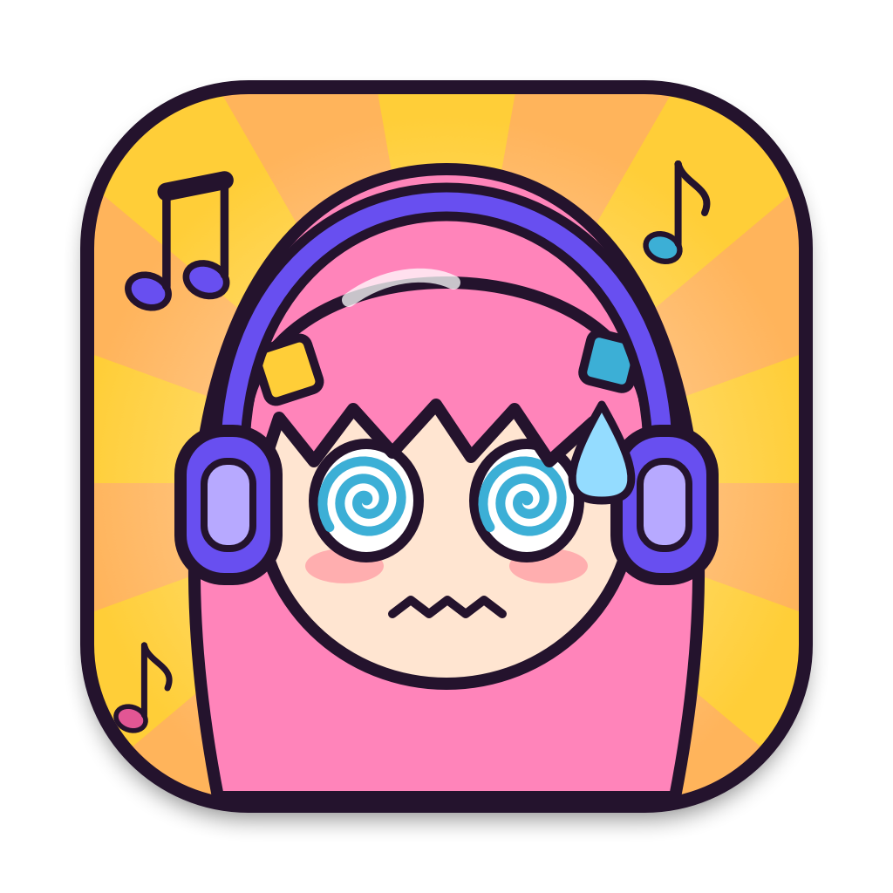

# Song Notifier



A tiny macOS menu bar app that pops up a notification whenever the song changes —
in **any browser** (Edge, Chrome, Safari… e.g. YouTube, YouTube Music, Spotify Web),
**Apple Music**, or **Spotify**.

```
┌──────────────────────────────────────────┐
│ 🎧 Song Notifier                     now │
│ Với Anh Em Vẫn Là Cô Bé                  │
│ KAI Hâm Nhạc                             │
└──────────────────────────────────────────┘
```

## How it works

- Reads the system **Now Playing** info (the same data shown in Control Center) via
  [`media-control`](https://github.com/ungive/media-control), which is **bundled inside the app**: nothing else to install.
  Apple restricts direct access to this on macOS 15.4+; `media-control` works around it.
- Waits ~1 s after a change so late-arriving artist/album metadata lands in the same popup,
  and notifies once per track title (pause/resume does not re-notify).
- Shows the song rolling through the menu bar (♫ item). Click it for a now-playing card: the player's artwork on
  the left (click it to jump to the player); title, artist and **⏮ ⏯ ⏭** icon buttons on the right (works for any
  player), with a small soundwave that moves while music plays. Below it: a quick
  **Show popups** switch, **Settings…** and **Quit**.
- Click a popup to jump to the player: the app comes to the front, and in Edge/Chrome/Brave/Vivaldi/Safari
  the tab playing the song is selected (macOS asks once to allow controlling the browser).
- Keeps a **Recently Played** list in the menu: the last 10 songs, each with how many times it played.
  The song's **link is stored with the row** (read from the browser tab while it plays), so picking a row goes
  back to that song — the tab is selected if it is still open, and if it is not, the stored link is opened in
  the same browser. **Clear Recently Played** empties the list; turn the whole thing off in Settings to keep
  nothing.
- Runs as a background app (`LSUIElement`, no Dock icon).

## Settings

Open from the menu bar item (or by opening Song Notifier again if the item is hidden):
**Launch at login** (a regular macOS login item, listed in System Settings → General → Login Items),
**show the song in the menu bar**, **roll long titles**, the **menu bar size** (1x, 0.8x or 0.5x width),
**show popups**
(turn popups off to keep just the menu bar title), and **keep a list of recently played songs**.

## Install

### Homebrew (easiest)

```sh
brew tap minhquandev91/tap
brew trust minhquandev91/tap
brew install --cask song-notifier
```

Recent Homebrew versions refuse to load anything from a tap you haven't trusted (the error says
`Refusing to load ... from untrusted tap`), hence the `brew trust` line. Older versions don't have it; skip it there.
Then open **Song Notifier** and tick **Launch at login** if you want it at startup.

### Manual download

1. Download `SongNotifier-<version>.zip` from the [latest release](https://github.com/minhquandev91/song-notifier/releases/latest),
   unzip it and move **SongNotifier.app** to `/Applications` (or `~/Applications`).
2. The app is signed ad-hoc (not notarized), so macOS blocks the first launch: right-click the app → **Open** → **Open**,
   or run `xattr -dr com.apple.quarantine /Applications/SongNotifier.app`.

Requires macOS 13+ on Apple Silicon (tested on macOS 27). Nothing else needs installing.

## Build from source

```sh
brew tap ungive/media-control && brew install media-control   # only so build.sh can copy it into the app
./build.sh
```

`build.sh` compiles the app into `~/Applications/SongNotifier.app`, renders the icon, signs it ad-hoc, and starts it
(it also removes the pre-0.2.0 launchd agent). On first run the Settings window opens: tick **Launch at login**
if you want it at startup, and allow notifications from **Song Notifier** when macOS asks
(or in System Settings → Notifications).

UI layout check: `~/Applications/SongNotifier.app/Contents/MacOS/song-notifier --snapshot /tmp/ui` renders the
menu card and settings window (light and dark) to PNGs without showing anything on screen, and writes the menu
structure to `menu.txt` / `menu-empty.txt`. `--history-test` checks the list end to end — de-duplication,
play counts, stored links, cap, persistence and clear (against a throwaway defaults suite), then feeds
synthetic media-control lines plus the live song through the app's own detection path and prints the
resulting menu. `--focus-test` checks the browser navigation (it activates a browser, so run it on purpose):
`--focus-test` follows what is playing now, `--focus-test "<title>"` a given song, `--focus-test --row N`
row N of the real list, and `--focus-test --open-url` the stored-link branch — all through the same handler
a click calls.

## Custom icon picture

Drop any square-ish picture at `tools/icon-source.jpg` (or `.png`) and run `./build.sh` —
it is cropped to a full-bleed square with a ♫ badge (macOS applies the rounded mask). Without it, the code-drawn icon is used.
The picture is git-ignored, so third-party artwork stays out of the repo.

`./package.sh` builds a shareable `dist/SongNotifier-<version>.zip` (always with the code-drawn icon, never your custom picture).

## Manage

Quit from the menu bar item. Uninstall: untick **Launch at login**, quit, then delete
`~/Applications/SongNotifier.app` and this folder.

## Files

| File | Purpose |
|---|---|
| `SongNotifier.swift` | The app: reads the `media-control stream` JSON, posts notifications, menu bar item, settings window |
| `Info.plist` | App bundle metadata (bundle id, background-only, icon) |
| `tools/make-icon.swift` | Draws the default icon in code: a nervous pink-haired guitarist girl with headphones |
| `tools/make-icon-from-image.swift` | Turns any picture into an icon (full-bleed square crop + music-note badge) |
| `package.sh` | Runs `build.sh`, then zips the app to `dist/` for sharing |
| `build.sh` | Build + install + (re)start (and remove the old launchd agent) |

## Troubleshooting

- **No popup:** check System Settings → Notifications → Song Notifier, and Focus mode.
- **Old icon showing:** `killall NotificationCenter Dock` (macOS caches icons).
- **Blank icon in the popup:** macOS caches the notification icon per bundle id, including a blank
  one from a build that had no icon yet. Bump `CFBundleIdentifier` in `Info.plist` and rebuild.

## License

[MIT](LICENSE): free to use, modify and distribute.

The app bundles [`media-control`](https://github.com/ungive/media-control) and
[`mediaremote-adapter`](https://github.com/ungive/mediaremote-adapter) by Jonas van den Berg (BSD 3-Clause);
see [THIRD_PARTY_NOTICES.md](THIRD_PARTY_NOTICES.md).

---

Copyright © 2026 RedhairedQuan
